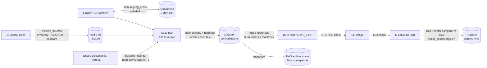

# Backup · Deduplication · Optical-Media Audit · M-DISC Archival

**Verified consolidation of ~35 years of personal data into one deduplicated, hash-verified corpus — and its long-term archival on M-DISC with a bit-level verification chain.**

   

> Deutsche Kurzfassung: [docs/de/projektbericht.md](docs/de/projektbericht.md)

---

## 1. Problem

Data had accumulated over decades across **51 optical discs (CD/DVD/BD)**, a 1 TB legacy HDD archive, Google Drive, a Synology NAS and four end devices (Windows, Ubuntu, TUXEDO OS). Typical symptoms:

- the same file in up to a dozen places, different folder structures everywhere
- optical discs with **read errors** — and, worse, **silent read errors** (the drive returns wrong data without reporting an error)
- no verified backup: sync mirrors were mistaken for backups, no restore test
- no single "source of truth", so nobody could say what was complete

**Goal:** one deduplicated, verified master corpus (`D:\Daten`) and a real 3-2-1 backup: NAS + two offline M-DISC sets (one off-site), each copy provably identical to the master.

## 2. Approach (engineering principles)

| Principle | Implementation |
|---|---|
| **Sources are read-only** | Live folders (Pictures, Videos, Documents, Drive) are never modified; consolidation happens only in the target |
| **Never delete, quarantine** | Duplicates are *moved* into a quarantine with a marker file and an enforced 7-day waiting period; masters are never touched |
| **Dry run → pilot → full run** | Every mass operation produces a plan (CSV) first; a pilot with a known target count runs before the full run |
| **Inventory before change** | Path, size, mtime and SHA-256 are stored *before* the first change, so the result is provable afterwards |
| **Hash, don't trust** | Every copy is verified by SHA-256; "0 read errors" is never accepted as proof of correct content |
| **Never rename, version** | Each new state goes into a new versioned folder (`D2_V1`, `D2_V2`…); tools detect the next version themselves |
| **Separate finding types** | Reports list each finding class separately (missing, size, hash, read error, extra…) — no class may hide another |

## 3. Pipeline



## 4. Results (measured)

| Stage | Result | Date |
|---|---|---|
| Optical-media audit | 51 discs read; 193,601 files, 457.64 GiB raw → **245.04 GiB unique**; 34,532 files / 148.42 GiB imported | 25.–28.10.2026 |
| Silent read errors found | **6,289 files on 16 discs** returned different content than the same file elsewhere — without any read error. Found only by cross-source comparison, not in single-disc runs | 28.10.2026 |
| Legacy archive dedup | 339,345 files inventoried; **263,134 byte-identical duplicates (791.97 GiB) quarantined**; 0 master files changed; 0 deleted | 21.10.2026 |
| Consolidation `D:\Daten` | 128,584 files, 336.03 GiB (292.25 GiB unique, 28,767 hardlinks); full-hash verification: **0 errors, 0 hash deviations** | 29.10.2026 |
| M-DISC ISO verification (D3–D6) | **117,821 files / 324.27 GiB, 0 deviations** in all finding classes | 01.11.2026 |
| Burn defect root cause (D2) | 26,599 sectors differing from the ISO classified at byte level: 26,506 = padding after end-of-file (burn path re-mastered the image), 93 = unreadable CRC zone; file contents unaffected (sample) | 01.11.2026 |

Status: M-DISC set A in progress (D1 verified on disc; D2 re-burn and D3–D6 burns pending), NAS copy and off-site set B pending.

## 5. Engineering highlights

- **Silent-read-error detection.** Same path + size + date but different hash across sources ⇒ defect suspicion, not "new version". Byte comparison showed a repeating 16-sector pattern.
- **Deterministic UDF name shortening.** CDBurnerXP (UDF 2.50) silently truncates names > 127 UTF-16 code units, which broke one ISO check. The burn-list tool now shortens names and over-long paths *deterministically* (`<start>~<sha256-prefix>.<ext>`) and writes the mapping to `_MANIFEST\Kurznamen_D<n>.csv` (unit tests in `tests/`).
- **Verification chain.** `ORDNER` (burn folder vs manifest) → `ISO` (mounted image, label check) → burn **from the ISO** → `ROH` (raw sector read vs ISO up to the partition end) → append-only register row.
- **Byte-level root-cause analysis.** `mdisc_sektorvergleich` maps every differing sector to the UDF file extents and classifies it (`NACH_EOF`, `DATEN`, `FREI`, `UNKLAR`) instead of discarding a disc on a raw mismatch count.
- **Windows reality.** Python reports Win32 CRC errors as `Errno 13 Permission denied`; the tools log the real `winerror` code. Long-path prefix `\\?\`, PowerShell 5.1 BOM handling and hardlink semantics over SMB are handled explicitly.
- **Known deviations are machine-readable.** Two Drive `.lnk` files rewritten by the Drive client after the plan snapshot are carried as a documented, re-hashed exception list instead of a manual note.

## 6. Repository layout

```
src/
  optical_media_audit/  medien_pruefen_v1.5.py      one-command disc audit: inventory, compare, import, partial rescue, report
                        medien_image_ddrescue_v1.0.sh  ddrescue imaging for damaged discs (Linux)
  dedup_cleanup/        bereinigung_archiv.py       hash-based dedup with quarantine and 7-day lock
                        archiv_pruefung.py          post-check against the stored inventory
                        bestand_inventar_v1.1.py    read-only inventory with SHA-256 (T0 snapshot)
  format_check/         k7_formatpruefung_v1.1.py   content plausibility per format (JPEG/PDF/ZIP/text), calibrated on known-good files
  mdisc_archival/       mdisc_brennliste_v1.5.py    burn folders, manifests, redundancy layer, name/path shortening
                        mdisc_pruefen_v1.2.py       checks ORDNER/ISO/DISC/ABBILD/ROH/REGISTER
                        mdisc_serie_v1.0.py         batch runner for several discs
                        mdisc_sektorvergleich_v1.1.py  sector-level comparison disc ↔ ISO with UDF extent mapping
                        mdisc_ende_v1.0.py, mdisc_lesetest_v1.0.py, mdisc_brenner_check_v1.0.ps1, takeout_teilliste_v1.0.py
tests/                  unit tests (pytest)
docs/                   architecture, verification chain, results, lessons learned, data protection
```

File names keep their version suffix on purpose: they are the versions that actually ran, and the scripts call each other by these names. Code comments and console output are German (original working language).

## 7. Quick start

Requirements: Python ≥ 3.10 (developed and run with 3.12), standard library only. Windows 11 for the optical/ISO stages (`Mount-DiskImage`, IMAPI2); Linux for `ddrescue`.

```bash
python -m pip install -r requirements-dev.txt   # only for tests/lint
python -m pytest -q
python src/mdisc_archival/mdisc_pruefen_v1.2.py --help
```

Mutating steps are explicit: `mdisc_brennliste` only plans unless `--ausfuehren` is given; `bereinigung_archiv` defaults to `--modus report`, and emptying the quarantine (`--modus leeren`) needs the confirmation word `LOESCHEN` plus the expired 7-day lock; `medien_pruefen` reads the disc and copies only into its own import folder (`--nur-pruefen` skips the import). Paths in the code are the original Windows paths with the user name replaced by `<USER>` — adapt them before use.

## 8. My role

Problem definition, risk rules (read-only sources, quarantine instead of delete, versioned states), acceptance criteria and test design, execution and observation on Windows hardware, review of every report, root-cause analysis and all decisions. The code was written in **human–AI pair programming with Claude (Anthropic)** — including the discipline that makes that reliable: claims about script behaviour are verified against the source, every result is reconciled against independent counts, and every failure produced a written lesson ([docs/lessons-learned.md](docs/lessons-learned.md)).

Background: Dipl.-Wirtschaftsingenieur (FH), ~35 years in mechanical engineering, production, maintenance, quality management (ISO 9001 / IATF 16949 auditor background) and automation; IBM AI Developer and Data Science certificates. The project applies QM methods — inventories, measurement system analysis, 8D-style root-cause work, append-only records — to data engineering.

## 9. Related repository (phase 1)

[gnembac/HDD_Duplicate_sort](https://github.com/gnembac/HDD_Duplicate_sort) — the first iteration (July 2026): `datenarchiv.py` inventories nested backup folders in SQLite, finds byte-identical duplicates with BLAKE2b, reports image variants and proposes a new folder structure. This repository is phase 2: it adds optical-media auditing, silent-read-error detection, the planned consolidation with full-hash verification and the M-DISC verification chain.

## 10. Data protection

No personal data is published: no file lists, manifests, reports or folder contents. Scripts were sanitised (user name, account name, private folder names replaced); see [src/PROVENANCE.md](src/PROVENANCE.md) and [docs/data-protection.md](docs/data-protection.md).

## 11. License

Apache License 2.0 — see [LICENSE](LICENSE).
